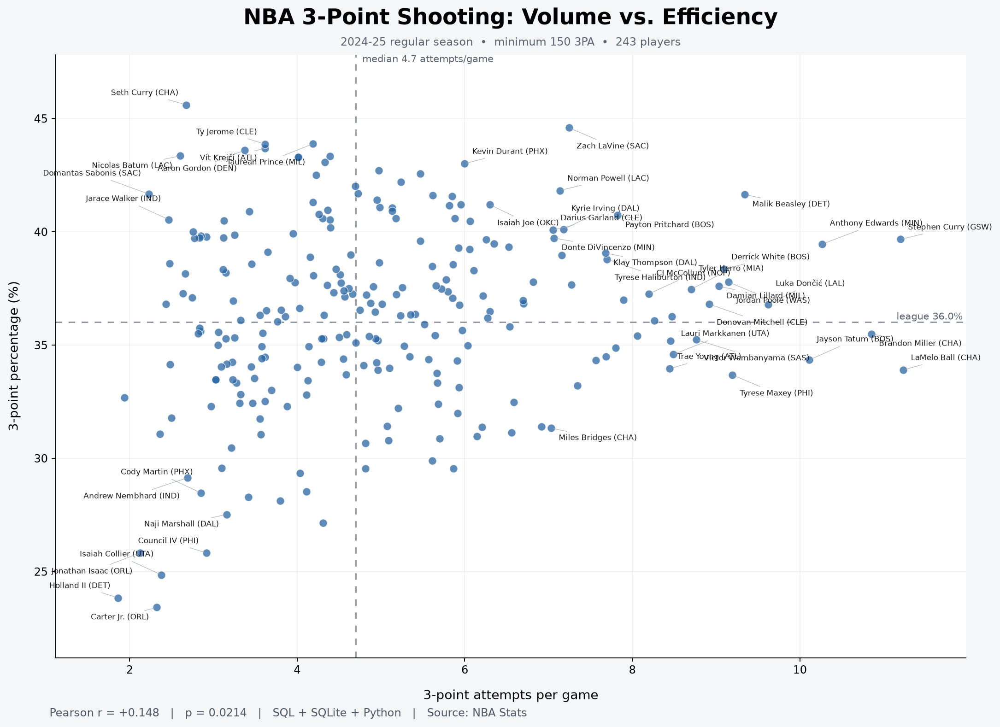

# NBA 3-PT Shooting Analysis: Volume vs. Efficiency

Analyzing the relationship between three-point shooting volume and efficiency during the 2024–25 NBA regular season using Python, SQLite, and statistical testing.

## Overview

Do NBA players shoot at different efficiency levels depending on the number of three-point shots they attempt?

This analysis uses official NBA player statistics, filters for players who attempted at least 150 three-point shots, and calculates shooting volume and accuracy using SQL.

## Visualization



The scatterplot compares three-point attempts per game against three-point percentage, with reference lines highlighting median shooting volume and league-wide shooting efficiency.

## Statistical Analysis

The project uses Pearson's correlation test and ordinary least squares (OLS) linear regression to examine the relationship between shooting volume and efficiency.

- **Null Hypothesis (H₀):** There is no linear correlation between three-point attempts per game and three-point percentage.
- **Alternative Hypothesis (H₁):** A nonzero linear correlation exists.
- **Significance Level:** α = 0.05

## Results

See [`output/findings.txt`](output/findings.txt) for the Pearson correlation coefficient, p-value, and regression slope.

Statistical significance does not imply causation. Other factors may influence the observed relationship, including shot difficulty, the minimum-attempt threshold, shot location, defender proximity, and player roles.

## Technologies

- **Python:** pandas, Matplotlib, NumPy, SciPy
- **SQL / SQLite:** Data storage, filtering, and aggregation
- **NBA API:** Official NBA player statistics

## How to Use

Clone the repository, navigate to the project directory, and run the following commands:

```bash
python3 -m venv .venv
source .venv/bin/activate
pip install -r requirements.txt
python main.py --season 2024-25
```

Generated outputs are saved in the `output/` directory.

## Data Source

[NBA.com/stats — Official NBA Player Statistics](https://www.nba.com/stats/players/traditional)
